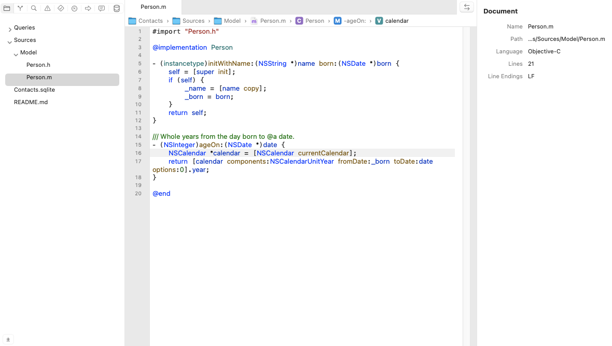
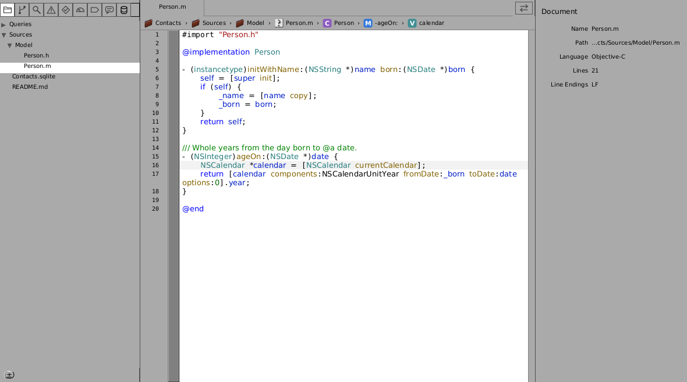
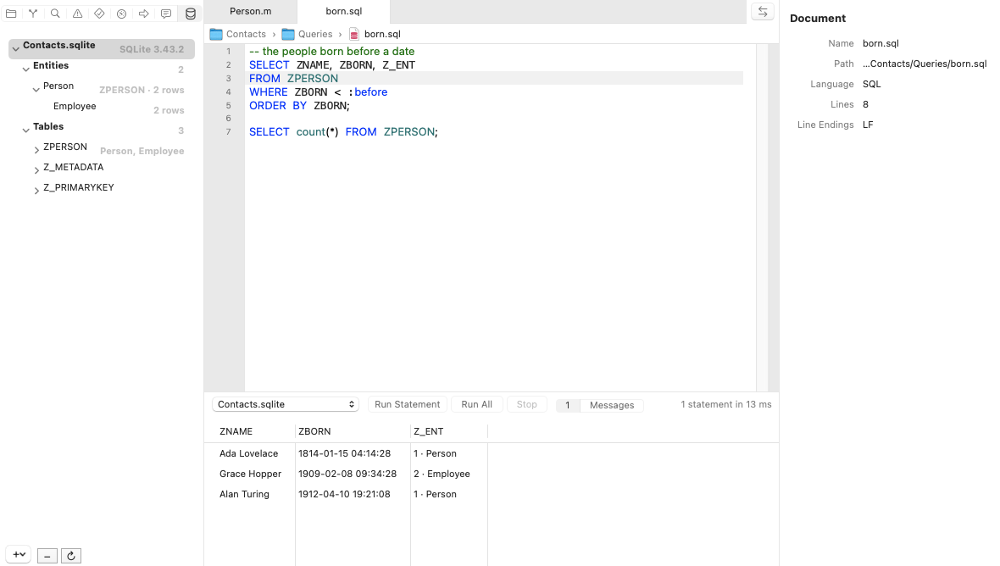
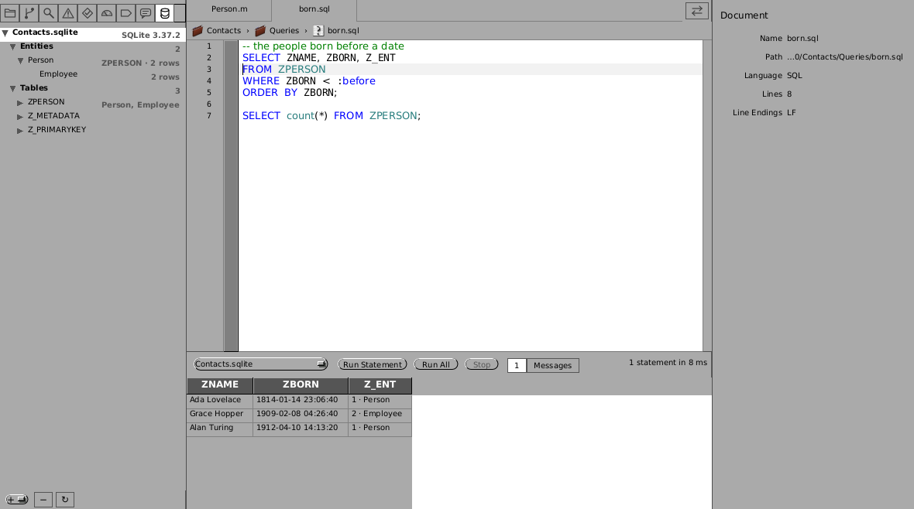
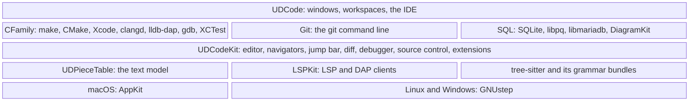

# UDCode and UDCodeKit

A native code editor in Objective-C, for **macOS, Linux and Windows
(GNUstep)**. It looks like Xcode and works like VS Code: VS Code's text
model, ported; tree-sitter for highlighting, folding and outlines; language
servers (LSP) for the rest; any debugger that speaks DAP; git as VS Code's
git extension runs it; databases, Core Data stores among them. **UDCodeKit**
is the editor as a library, for other apps to embed; **UDCode** is the app
built on it, a C and Objective-C IDE.

| macOS | Linux (GNUstep) |
|:---:|:---:|
|  |  |
|  |  |

## Get it

Download from [Releases](https://github.com/ashalkhakov/UDCodeKit/releases/latest):

| Platform | Download | Contains |
|---|---|---|
| macOS 15.7+ | `UDCode-macOS-*.zip` | The app, signed and notarized; updates itself (Sparkle) |
| Linux x86_64 | `UDCode-*-x86_64.AppImage` | The app; updates itself |
| Windows x64 | `UDCode-*-win64.msi`, `UDCode-*-win64-portable.zip` | The app, installed or not; updates itself (WinSparkle) |
| Libraries | `udcodekit-*-apple.zip`, `udcodekit-*-ubuntu22.04-*.tar.xz`, `udcodekit-*-windows-clang64-*.tar.xz` | UDPieceTable, LSPKit and UDCodeKit (XCFrameworks for Apple), with the grammar bundles |

Every push also uploads unsigned builds to its [Actions run](https://github.com/ashalkhakov/UDCodeKit/actions).

Build from source (the grammars and the tree-sitter runtime are fetched at
pinned commits the first time):

    # macOS: open UDPieceTable.xcworkspace, scheme UDCode; or
    make -f Makefile.apple
    # Linux and Windows (MSYS2), with the GNUstep stack from gnustep-patches
    make && make check

## What works

- **Editing**: VS Code's piece tree, decorations, undo, search and multiple
  cursors, ported (`UDPieceTable`, each edit costing the edit, tested for
  it); find and replace; folding; auto-indent; bracket and quote pairs.
- **Languages**: tree-sitter modes for C, Objective-C, JSON, YAML, Markdown
  (with a preview), HTML, XML, Make, Bash and SQL, each a bundle; parse
  errors where the language has no server; links followed (⌘-click).
- **Language servers**: diagnostics, completion, hover, definitions and
  references, rename, formatting, fixes, signatures, semantic tokens,
  occurrences highlighted (clangd for C and Objective-C, LemMinX for XML).
- **IDE**: open a folder, Build (⌘B), Run (⌘R), Test (⌘U) and debug with
  the project's own tools — make, CMake, Xcode, GNUstep make; lldb-dap or
  gdb; XCTest, CTest, GoogleTest — `tasks.json` and `launch.json` read as
  VS Code reads them ([IDE](docs/ide.md), [debugging](docs/debugging.md)).
- **Jump bar**: Xcode's, over each editor — the project, its folders, the
  file, the symbols at the caret (the server's, or the mode's outline) —
  each a menu to go elsewhere.
- **Source control**: git, as VS Code's git extension runs it, in Xcode's
  Source Control navigator: changes, staging, commits, the change bars in the
  gutter, Code Review, Authors (blame), history, branches, tags, stashes,
  remotes, push and pull.
- **Databases**: SQLite, PostgreSQL, MySQL and MariaDB — connections, their
  tables and keys, queries run with their parameters, results under the
  query; a Core Data store's tables named by their entities, its dates and
  entities shown as such; ER diagrams (crow's feet, a Core Data store's
  links inferred; exported as PDF, PNG or SVG); PostgreSQL's and MySQL's client libraries are
  yours to install (`brew install libpq mariadb-connector-c`, say:
  [databases](docs/sql.md)).
- **More**: Code Review and comparing files side by side (VS Code's diff
  editor); a terminal; the Issues, Find, Test, Debug and Breakpoint
  navigators; Open Quickly.
- **Checked**: about 320 tests on every push, on macOS, Linux (x86_64 and
  aarch64) and Windows; the database drivers against real PostgreSQL, MySQL
  and MariaDB servers on Linux.

## Limitations

- **One folder a window**: no multi-root workspaces yet.
- **Settings**: a project's own (`.udcode/settings.json`, `tasks.json`,
  `launch.json`); no user or workspace settings layer yet
  ([#30](https://github.com/ashalkhakov/UDCodeKit/issues/30)).
- **Databases**: everyday work only — browsing, editing rows and a query
  builder are on their way
  ([#54](https://github.com/ashalkhakov/UDCodeKit/issues/54)); administration
  is left to each database's own tools.
- **Extensions** are bundles built with UDCodeKit, loaded into the app; there
  is no marketplace, and VS Code's extensions don't run.
- **GNUstep** needs the patched stack from
  [gnustep-patches](https://github.com/ashalkhakov/gnustep-patches); the
  fixes are on their way upstream.

## Architecture

Each layer uses only those below it. The core knows no build system,
debugger, version control or database: an extension brings them, as VS
Code's do, through UDCodeKit's protocols (`UDBuildSystem`, `UDDebugger`,
`UDSourceControl`, a workbench's navigators and commands). Every view is in
a XIB, compiled by Xcode and read as it is by GNUstep.

| Path | What |
|---|---|
| `UDPieceTable/` | The text model: piece tree, decorations, undo, search, cursors (Foundation only) |
| `UDCodeKit/` | The editor and the workbench, as a framework for apps to embed |
| `LSPKit/` | The Language Server and Debug Adapter Protocol clients |
| `Sources/` | UDCode, the app |
| `Plugins/CFamily/` · `Git/` · `SQL/` | UDCode's extensions: C and Objective-C, git, databases |
| `tree-sitter-<lang>/` | Grammar bundles: the grammar, its queries (`highlights.scm`, `outline.scm`) |
| `Tests/` · `UDPieceTable/Tests/` | The editor's and the text model's tests |
| `docs/` | How it works, and how it compares with VS Code |

## Documentation

- [UDCode as an IDE](docs/ide.md) · [Debugging](docs/debugging.md) · [Databases](docs/sql.md)
- [UDCodeKit and VS Code, side by side](docs/architecture.md)
- [Grammar bundles](docs/grammar-bundles.md)

## License

MIT ([LICENSE.md](LICENSE.md)): the ported VS Code code is Microsoft's, under
MIT. LSPKit, the tree-sitter runtime and the upstream grammars are MIT as
well.
